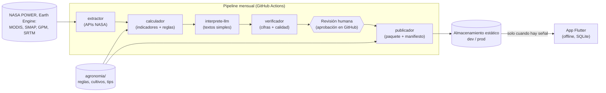

# ARQUITECTURA.md — Estructura del proyecto "Rotación Inteligente Piura"

> Documento vivo (creado el 2026-11-14). Complementa a `AGENTS.md` (reglas y equipo) e `IDEA.md` (qué construimos).
> Aquí se define **cómo** está armado: servicios, carpetas, contratos, control de versiones y entornos.
> Todo cambio de estructura se propone por Pull Request y se registra en la sección 10.

---

## 1. Resumen en una frase

Una **app Flutter que funciona sin internet** lee un **paquete de datos mensual**. Ese paquete lo produce una cadena de **microservicios ligeros** (extractor → calculador → intérprete LLM → verificador → publicador) que corre una vez al mes, primero en **desarrollo** y, tras aprobación humana, en **producción**.

## 2. Requisitos que guían el diseño

| Requisito | Meta | Por qué importa |
|---|---|---|
| Funciona sin internet | 100 % de la app usable en modo avión | Agricultores sin señal en el campo |
| Paquete mensual pequeño | < 5 MB comprimido `[ESTIMADO]` | Se descarga rápido con 3G o un punto Starlink |
| Celulares de gama baja | Android 8+, app < 30 MB | Es lo que hay en el campo |
| Accesible | Letra grande, alto contraste, semáforo, poco texto | Adultos mayores y jóvenes que inician |
| Transparente | Puntajes por reglas, LLM solo explica | Requisito del reto y confianza del agricultor |
| Barato | LLM < US$10 por mes `[ESTIMADO]`, hosting gratuito | Proyecto de hackathon |
| Revisado por personas | Ningún paquete llega a producción sin aprobación | Retroalimentación del mentor (IDEA.md §12) |
| Sin secretos en el teléfono | La app nunca guarda llaves de APIs | Seguridad: una app se puede descompilar |

## 3. Arquitectura general



### 3.1 ¿Por qué "microservicios ligeros" y no microservicios clásicos?

Nuestro sistema es un **proceso por lotes mensual**, no una plataforma con miles de peticiones por segundo. Microservicios clásicos (Kubernetes, colas de mensajes, base de datos por servicio, API gateway) serían sobreingeniería para 48 horas y 5 personas.

Tomamos lo que sí nos sirve de los microservicios:

| Principio | Cómo lo aplicamos |
|---|---|
| Cada servicio tiene una sola responsabilidad y un dueño | Un servicio por etapa, cada uno con su responsable (sección 5) |
| Contratos claros entre servicios | JSON Schema versionados en `contratos/` (sección 6) |
| Comunicación asíncrona y desacoplada | Cada etapa escribe archivos; la siguiente los lee. Ningún servicio llama a otro directamente |
| Cada servicio es dueño de sus datos | Cada etapa escribe solo en su carpeta de la corrida (`runs/<entorno>/<run_id>/<etapa>/`) |
| Despliegue y prueba independientes | Cada servicio tiene su `Dockerfile`, sus tests y se puede ejecutar solo con datos de ejemplo |
| Diseñar para fallas | Tiempos de espera y reintentos en cada API externa; plantillas si falla el LLM; si una etapa falla, no se publica nada |
| Trazabilidad | Un `run_id` (ej. `2026-11-a1b2c3`) viaja en todos los archivos y logs de la corrida |

Lo que **no** hacemos (y por qué): no hay Kubernetes, ni colas de mensajes, ni servidores siempre encendidos. El único componente "en línea" es un almacenamiento estático con el paquete. Si algún día el proyecto crece, cada servicio ya está separado y se puede desplegar aparte.

### 3.2 Servicios

| Servicio | Entrada | Salida | Tecnología |
|---|---|---|---|
| `extractor` | Grilla de Piura + periodo | Datos crudos por celda (`crudos.parquet`) y registro de qué faltó | Python, `earthengine-api`, `requests`, `xarray` |
| `calculador` | Crudos + `agronomia/` | `hechos.json` por zona: indicadores, semáforo, subpuntajes por criterio, aptitud por cultivo y temporada, rotaciones | Python, `pandas`, reglas en YAML |
| `interprete-llm` | `hechos.json` | `interpretacion.json`: textos simples por zona (por qué, evidencia, beneficios, lagunas, riesgos) | Python, Claude API con *structured outputs* |
| `verificador` | `hechos.json` + `interpretacion.json` | `informe.md` del mes + interpretación aprobada o con plantillas | Python, `pydantic` |
| `publicador` | Todo lo aprobado + tips y glosario | `paquete-AAAA-MM.sqlite.gz` + `manifest.json` (versión, fecha, `sha256`) | Python, `sqlite3` |
| `app` | `manifest.json` + paquete | Pantallas offline | Flutter (Dart), `sqflite`/`drift`, `flutter_map`, `geolocator` |

**Decisión clave para que la app funcione offline sin duplicar reglas:** el `calculador` (Python) precalcula todo: aptitud por celda × cultivo × temporada, y los **subpuntajes por criterio** (agua, ingresos, suelo, erosión, clima, mercado). El teléfono solo hace una **suma ponderada** con los deslizadores del agricultor (fórmula documentada en `contratos/`). Así las reglas agronómicas viven en un solo lugar.

## 4. Estructura de carpetas (monorepo)

Un solo repositorio (`Gamio501/Doc-Nasa`) con todo: menos confusión, un solo lugar para Pull Requests y contratos compartidos.

```
Doc-Nasa/
├── AGENTS.md                  # Reglas del proyecto y del equipo (documento madre)
├── IDEA.md                    # Qué construimos
├── ARQUITECTURA.md            # Este documento
├── README.md                  # Cómo levantar el proyecto en 5 minutos
├── .github/
│   ├── CODEOWNERS             # Quién revisa cada carpeta
│   ├── pull_request_template.md
│   └── workflows/
│       ├── ci-app.yml         # flutter analyze + flutter test
│       ├── ci-servicios.yml   # ruff + pytest de cada servicio
│       └── pipeline-mensual.yml  # corrida mensual dev → aprobación → prod
│
├── app/                       # App Flutter (Persona 3)
│   ├── lib/
│   │   ├── main_dev.dart      # Punto de entrada entorno desarrollo
│   │   ├── main_prod.dart     # Punto de entrada entorno producción
│   │   ├── core/              # config por entorno, tema, textos en español, base SQLite
│   │   ├── data/              # lectura del paquete, descarga y verificación sha256
│   │   ├── features/
│   │   │   ├── mi_zona/           # clima y tierra con semáforo
│   │   │   ├── recomendaciones/   # mapa, ficha de zona, ranking, "quiero sembrar", rotaciones
│   │   │   ├── tips/              # guías, modo aprendiz, glosario
│   │   │   └── actualizacion/     # buscar y aplicar paquete nuevo
│   │   └── shared/widgets/    # semáforo, aviso "no reemplaza al experto", tarjetas
│   ├── assets/paquete_demo/   # Paquete incluido para la demo en modo avión
│   └── test/
│
├── services/                  # Microservicios del pipeline mensual
│   ├── extractor/             # (Persona 2)
│   ├── calculador/            # (Persona 2 + Persona 4)
│   ├── interprete-llm/        # (Persona 5)
│   │   ├── prompts/           # Prompt de sistema versionado (sistema_v1.md, …)
│   │   ├── plantillas/        # Textos de respaldo sin LLM
│   │   └── evals/             # Casos de prueba revisados por el agrónomo
│   ├── verificador/           # (Persona 5)
│   └── publicador/            # (Persona 2)
│   # Cada servicio: src/, tests/, Dockerfile, requirements.txt, README.md
│
├── orquestador/               # Script que encadena las etapas y genera el run_id (Persona 2)
│
├── contratos/                 # JSON Schema compartidos — "la ley" entre servicios y app
│   ├── hechos.schema.json
│   ├── interpretacion.schema.json
│   ├── paquete.schema.md      # Tablas SQLite del paquete
│   ├── manifest.schema.json
│   └── formula_puntaje.md     # Suma ponderada que hace el teléfono
│
├── agronomia/                 # Conocimiento agronómico como datos (Persona 4)
│   ├── cultivos.yaml          # ciclo, agua, raíz, tolerancia a sequía, mercado
│   ├── reglas.yaml            # umbrales del semáforo y de aptitud
│   ├── rotaciones.yaml        # rotación actual + alternativas
│   ├── tips/                  # una guía .md por cultivo + modo aprendiz
│   └── glosario.yaml
│
├── diseno/                    # Diseño UX/UI (Persona 5)
│   ├── tokens.json            # colores (incluido semáforo), tipografía, tamaños
│   ├── wireframes/            # capturas o enlace a Figma
│   ├── iconos/
│   └── textos.md              # copy en español sencillo para cada pantalla
│
├── infra/
│   ├── docker-compose.yml     # Levantar el pipeline completo en local
│   └── config/
│       ├── dev.example.env    # Variables de desarrollo (sin secretos reales)
│       └── prod.example.env
│
├── PLAN_INVESTIGACION.md, BENCHMARK_GANADORES.md, SPEC_MVP.md
│                              # Siguen en la raíz por ahora para no romper referencias
├── docs/
│   ├── decisiones/            # ADR: una decisión importante por archivo
│   ├── investigacion/         # Informes nuevos de investigación
│   └── pitch/                 # guion del video, diapositivas
│
└── PRACTICANDO/               # Práctica web previa. No se toca; sirve de plan B de demo
```

**Regla de oro de carpetas:** cada persona trabaja principalmente en sus carpetas. Lo que se comparte (`contratos/`, `agronomia/`) solo se cambia por Pull Request revisado por los dueños de ambos lados.

## 5. Dueños por carpeta (según roles de `AGENTS.md` §5)

| Carpeta | Responsable | Suplente |
|---|---|---|
| `docs/`, `README.md`, pitch y video | Persona 1 (Líder / storyteller) | Persona 5 |
| `services/extractor`, `calculador`, `publicador`, `orquestador/`, `infra/` | Persona 2 (Datos geoespaciales) | Persona 5 |
| `app/` | Persona 3 (Flutter) | Persona 5 |
| `agronomia/` | Persona 4 (Agronomía) | Persona 1 |
| `services/interprete-llm`, `verificador`, `diseno/` | Persona 5 (IA / UX) | Persona 3 |
| `contratos/` | Persona 2 + Persona 3 + Persona 5 (los tres deben aprobar) | — |

Al definir los nombres reales, reemplazar "Persona N" por el usuario de GitHub en `.github/CODEOWNERS`.

## 6. Contratos entre servicios

Los contratos evitan que la app y el pipeline "se entiendan mal". Se escriben **antes** del código.

- Cada archivo lleva `schema_version` (ej. `"1.0"`). Un cambio que rompe compatibilidad sube la versión mayor (`2.0`) y se avisa a todo el equipo.
- Python valida con `pydantic`; Flutter genera sus modelos desde el mismo esquema (`json_serializable`).
- Ejemplo mínimo de un hecho:

```json
{
  "schema_version": "1.0",
  "run_id": "2026-11-a1b2c3",
  "zona_id": "PIU-0412",
  "indicador": "humedad_suelo",
  "valor": 0.12,
  "unidad": "m3/m3",
  "periodo": "2026-10",
  "resolucion_km": 9,
  "fuente": "SMAP SPL3SMP_E",
  "confianza": "media",
  "es_dato_de": "zona"
}
```

## 7. Control de versiones en GitHub

### 7.1 Ramas

```
main      ← producción. Protegida. Solo entra por Pull Request aprobado.
develop   ← desarrollo. Protegida. Aquí se integra todo el trabajo del equipo.
feat/…    ← una funcionalidad. Sale de develop y vuelve a develop.
fix/…     ← un arreglo.
docs/…    ← solo documentación.
```

Nombre de rama: `tipo/area-descripcion-corta`. Ejemplos: `feat/app-mapa-offline`, `feat/extractor-power`, `fix/calculador-999`, `docs/pitch-guion`.

### 7.2 Flujo de trabajo de cada persona

```bash
# 1. Siempre partir de develop actualizado
git switch develop
git pull --rebase

# 2. Crear la rama de la tarea
git switch -c feat/app-mapa-offline

# 3. Trabajar con commits pequeños
git add app/lib/features/recomendaciones/
git commit -m "feat(app): mapa de Piura con polígonos offline"

# 4. Antes de subir, traer lo último de develop
git fetch origin
git rebase origin/develop

# 5. Subir y abrir Pull Request hacia develop
git push -u origin feat/app-mapa-offline
gh pr create --base develop --fill
```

### 7.3 Mensajes de commit

Formato: `tipo(área): descripción en español`

- **Tipos:** `feat`, `fix`, `docs`, `test`, `refactor`, `chore`, `ci`.
- **Áreas:** `app`, `extractor`, `calculador`, `interprete`, `verificador`, `publicador`, `orquestador`, `agronomia`, `diseno`, `contratos`, `infra`, `docs`.
- Ejemplos: `fix(calculador): -999 se guarda como null`, `feat(agronomia): reglas de aptitud del limón`.

### 7.4 Reglas para no equivocarnos

1. **Nadie hace push directo a `main` ni a `develop`.** Todo entra por Pull Request (se activa con protección de ramas en GitHub).
2. **Pull Requests pequeños**: una tarea, idealmente menos de 300 líneas. Más fácil de revisar y de deshacer.
3. **Un revisor como mínimo** (el dueño de la carpeta, según `CODEOWNERS`) y **CI en verde** antes de fusionar.
4. **Fusionar con "Squash and merge"** hacia `develop`: un commit limpio por tarea.
5. **`develop` → `main`** solo en los hitos de la sección 9, con Pull Request aprobado por el líder.
6. **Nunca subir secretos** (`.env`, llaves, cuentas de servicio). Están en `.gitignore`; si alguien sube uno por error, se avisa y **se cambia la llave de inmediato** (borrarla del historial no basta).
7. **Nunca subir datos pesados** de la NASA al repositorio: van al almacenamiento de la corrida.
8. Si dos personas necesitan tocar el mismo archivo, **se coordinan antes** por el canal del equipo.
9. Conflicto al hacer `rebase`: resolverlo en local, correr los tests y recién después `git push --force-with-lease` **solo en tu propia rama**.

### 7.5 Etiquetas de versión

- App: `app-v0.1.0`, `app-v0.2.0`… (versión de la demo, de la entrega).
- Datos: `datos-2026-11`, `datos-2026-12`… (un paquete mensual publicado en producción).

### 7.6 Configuración inicial (la hace el dueño del repositorio)

Solo el administrador del repositorio puede activar estas protecciones. En GitHub → **Settings**:

1. **Branches → Add branch ruleset** (o *Branch protection rule*) para `main` y otra para `develop`:
   - ✅ *Require a pull request before merging* → *Required approvals: 1*.
   - ✅ *Require status checks to pass* (activar cuando existan los workflows de CI).
   - ✅ *Block force pushes* y ✅ *Restrict deletions*.
2. **General → Pull Requests:** dejar activado solo *Allow squash merging*.
3. **Environments:** crear `desarrollo` y `produccion`. En `produccion`, ✅ *Required reviewers* (líder y/o agrónomo).
4. **Collaborators:** invitar a las 5 personas con rol *Write*.
5. Completar `.github/CODEOWNERS` con los usuarios reales de GitHub.

## 8. Dos entornos: desarrollo y producción

| Aspecto | Desarrollo (`dev`) | Producción (`prod`) |
|---|---|---|
| Rama | `develop` | `main` |
| Para qué | Probar cambios sin afectar a los agricultores | Lo que reciben los agricultores |
| Zona del pipeline | Una provincia de prueba (ej. Sullana o Morropón/Chulucanas) | Toda la región Piura |
| LLM | Llave de desarrollo con límite de gasto bajo | Llave de producción |
| Almacenamiento | `…/dev/manifest.json` | `…/prod/manifest.json` |
| App | Sabor `dev`: `main_dev.dart`, id `…app.dev`, ícono con etiqueta "DEV" | Sabor `prod`: `main_prod.dart`, id `…app` |
| Publicación | Automática tras pasar el verificador | Solo con **aprobación humana** en GitHub |

### 8.1 Cómo se separan

- **Servicios:** leen la variable `ENTORNO=dev|prod` y su archivo de configuración (`infra/config/dev.env` o `prod.env`, que **no** se suben; en el repo solo van los `.example.env`).
- **Secretos del pipeline:** guardados en **GitHub → Settings → Environments** (`desarrollo` y `produccion`), cada uno con sus propios `ANTHROPIC_API_KEY`, credenciales de Earth Engine y Earthdata.
- **App:** cada sabor recibe solo la URL de su manifiesto con `--dart-define-from-file=config/dev.json` o `prod.json`. La app **no lleva ninguna llave**: solo descarga archivos públicos.
- **Aprobación de producción:** el entorno `produccion` de GitHub exige un revisor (líder o agrónomo). Esa es la "revisión humana" del pipeline: el revisor lee `informe.md` y aprueba o rechaza.

### 8.2 Pipeline mensual (`pipeline-mensual.yml`)

1. Se dispara el **día 5 de cada mes** (para dar tiempo al retraso de la NASA) o a mano (`workflow_dispatch`).
2. **Job `dev`:** corre todas las etapas con la provincia de prueba y publica en `dev`.
3. **Job `prod`:** usa el entorno `produccion` → GitHub **espera la aprobación**. Al aprobar, corre con toda Piura y publica en `prod` con la etiqueta `datos-AAAA-MM`.
4. Si cualquier etapa falla, la corrida se detiene y **no se publica nada**; el último paquete bueno sigue vigente.

## 9. Hitos del hackathon (cuándo `develop` pasa a `main`)

| Hito | Contenido mínimo | Fusión a `main` |
|---|---|---|
| H1 — Esqueleto | Carpetas, contratos v1, CI básico, app que abre con datos de ejemplo | Sí |
| H2 — Datos reales | Pipeline corre una vez con NASA POWER + NDVI para la provincia de prueba | Sí |
| H3 — Demo completa | App con paquete real: mapa → ficha → ranking → "quiero sembrar" → tips, en modo avión | Sí (versión de entrega) |
| H4 — Pulido | Textos, accesibilidad, video y pitch | Sí, antes de la entrega |

Si el tiempo aprieta, H3 es lo que se entrega; H4 se recorta.

## 10. Decisiones de arquitectura (ADR resumidos)

Cada decisión importante se escribe completa en `docs/decisiones/ADR-NNN-titulo.md` (contexto, decisión, alternativas, consecuencias).

| ADR | Decisión | Alternativas descartadas | Costo de la decisión |
|---|---|---|---|
| 001 | App Flutter offline (no web) | Web PWA (Next.js), Kotlin nativo | Rehacer la maqueta web de `PRACTICANDO`; el equipo ya domina Dart |
| 002 | Microservicios ligeros por etapas, comunicados por archivos | Monolito único; microservicios clásicos con Kubernetes y colas | Más carpetas y contratos que un monolito; mucho menos operación que microservicios clásicos |
| 003 | El LLM solo explica; los puntajes los calcula el código | LLM que decide la recomendación | Más trabajo en reglas; a cambio, resultados explicables y sin cifras inventadas |
| 004 | Paquete mensual estático (o bimestral) | API en línea consultada por la app | Los datos tienen hasta un mes de antigüedad; a cambio, funciona sin señal |
| 005 | Monorepo con contratos compartidos | Un repositorio por servicio | Un repo más grande; a cambio, un solo lugar para revisar y versionar |
| 006 | Dos entornos con aprobación humana para producción | Un solo entorno | Un paso más cada mes; a cambio, ningún error llega a los agricultores |

## 11. Riesgos de arquitectura

| Riesgo | Mitigación |
|---|---|
| Los contratos cambian a mitad del hackathon y rompen la app | Contratos v1 en H1; cambios solo por PR aprobado por Persona 2, 3 y 5 |
| Demasiada estructura para 48 horas | Empezar cada servicio como un solo script dentro de su carpeta; separar en módulos solo si crece |
| Earth Engine o el LLM fallan durante la demo | La demo usa `app/assets/paquete_demo/`, generado antes |
| Alguien sube un secreto | `.gitignore` desde el primer commit, revisión en cada PR, rotar la llave si pasa |
| Conflictos de Git entre 5 personas | Dueños por carpeta, PR pequeños, `git pull --rebase` antes de empezar cada tarea |
